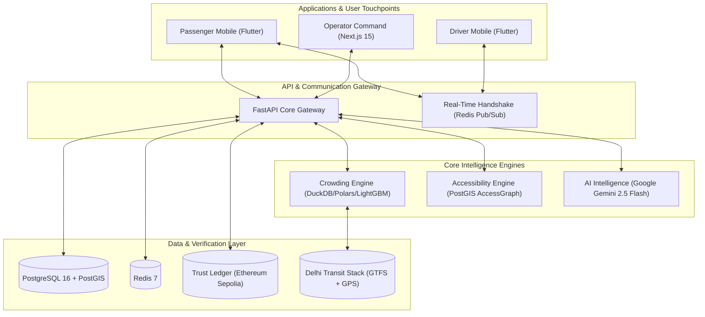

# YATRA — Your Accessible Transport & Reliable Assistance Platform

> **"Every Passenger. Every Bus. Every Journey."**

YATRA is an open-source, universal public transit accessibility, operations, and intelligence platform designed to eliminate physical, communicative, and cognitive barriers in municipal bus transit systems.

---

## 1. Product overview and vision

Municipal bus transit provides vital connectivity for Delhi, accommodating over 4 million daily journeys. However, passengers with mobility impairments, elderly commuters, and people traveling with strollers frequently encounter operational friction:
- Inaccessible bus stops and curbs with no advance accessibility ratings.
- Inability to notify approaching bus drivers of boarding requirements, resulting in buses stopping away from ramps or failing to lower kneeling mechanisms.
- Unpredictable bus crowding without real-time occupancy indicators.
- Drivers lacking advance notice of boarding passengers who require wheelchair ramps or assistance.
- Transport authorities lacking verifiable inspection and maintenance records.

**YATRA** addresses these bottlenecks by linking five user groups with shared, real-time accessibility and operational data.

---

## 2. User groups

| User group | Platform interface | Capabilities |
| :--- | :--- | :--- |
| **1. Commuters and daily passengers** | Universal Passenger App (`apps/passenger-mobile`) | Step-free route planning, live bus arrival telemetry, crowding indicators. |
| **2. Drivers and conductors** | DriverAssist console (`apps/driver-mobile`) | Pre-stop boarding assistance alerts, stop accessibility guidance. |
| **3. Operators and dispatchers** | Operator Command (`apps/operator-web`) | Fleet telemetry, crowding monitoring, accessibility incident triage. |
| **4. Passengers with disabilities** | Universal Passenger App (A11y mode) | High-contrast layout, screen-reader semantics, ramp boarding handshakes. |
| **5. Transport authorities** | Municipal Intelligence (`apps/operator-web`) | Aggregated compliance metrics, verifiable audit trails, corridor performance. |

---

## 3. Core modules

- **AccessGraph**: Stop and pedestrian path accessibility graph recording curb cuts, ramps, tactile paving, and shelter amenities.
- **AccessHandshake**: Real-time WebSocket signaling protocol connecting waiting passengers with approaching bus crews.
- **DriverAssist**: High-contrast operational driver console delivering audio and visual stop alerts.
- **Operator Command**: Desktop operations console for monitoring fleet status, managing boarding queues, and resolving maintenance tickets.
- **Crowd Intelligence**: Headway and telemetry-based crowding estimation using Delhi transit telemetry and electronic ticketing data.
- **Trust Ledger**: Ethereum Sepolia smart contract anchoring cryptographic audit hashes for accessibility inspections and resolved service tickets without storing personal data on-chain.

---

## 4. Architecture summary



---

## 5. Repository structure

```
yatra/
│
├── apps/
│   ├── passenger-mobile/          # Flutter passenger application (iOS/Android/Web)
│   ├── driver-mobile/             # Flutter driver tablet/phone application
│   └── operator-web/              # Next.js 15 App Router operator command dashboard
│
├── services/
│   ├── api/                       # Core FastAPI application (REST & WebSockets)
│   ├── crowding-engine/           # Bus occupancy & travel time prediction engine
│   ├── accessibility-engine/      # Stop accessibility scoring & routing graph
│   ├── handshake-engine/          # Passenger-to-driver real-time handshake service
│   ├── intelligence-engine/       # Google Gemini Gen AI contextual explanations
│   └── notification-service/      # Push and audio notification dispatch
│
├── blockchain/
│   ├── contracts/                 # Solidity smart contracts (TrustLedger.sol)
│   ├── scripts/                   # Foundry deployment & verification scripts
│   └── test/                      # Foundry unit & integration tests
│
├── packages/
│   ├── shared-types/              # Shared TypeScript definitions
│   ├── api-client/                # Typed API client library for frontend & node
│   └── design-system/             # Reusable accessible components & tokens
│
├── data/
│   ├── raw/                       # Raw input datasets (gitignored)
│   ├── processed/                 # Cleaned Parquet / DuckDB storage
│   ├── gtfs/                      # Delhi static GTFS schedules & routes
│   ├── gps/                       # Delhi bus GPS telemetry samples
│   ├── ticketing/                 # Delhi e-ticketing transaction summaries
│   └── sample/                    # Verified synthetic and minimal test fixtures
│
├── docs/
│   ├── product/                   # PRD, user personas, journeys
│   ├── architecture/              # System architecture, ADRs, tech stack
│   ├── api/                       # OpenAPI contract and schema specifications
│   ├── database/                  # PostGIS entity schemas, ERD, spatial indexes
│   ├── research/                  # Delhi Transit Stack analysis & ML strategy
│   ├── security/                  # Security policy, RBAC, privacy boundaries
│   ├── accessibility/             # WCAG 2.2 AA compliance standards
│   ├── blockchain/                # Trust ledger architecture & threat model
│   └── development/               # Comprehensive developer setup guide
│
├── scripts/                       # Local automation, seeders, data loaders
├── tests/                         # Integration, unit, and end-to-end fixtures
├── .env.example                   # Environment configuration template
├── .gitignore                     # Git ignore rules
├── Makefile                       # Developer command interface
├── docker-compose.yml             # Local PostgreSQL/PostGIS and Redis services
└── LICENSE                        # Apache 2.0 Open Source License
```

---

## 6. Development prerequisites

- **Python**: 3.12+ (isolated `.venv`)
- **Node.js**: 20+ (with npm 10+)
- **Flutter & Dart**: Flutter 3.13+ / Dart 3.1+
- **Docker**: Optional, for running local PostgreSQL 16 + PostGIS and Redis
- **Foundry**: Optional, for compiling and testing smart contracts

---

## 7. Quickstart commands

```bash
# 1. Clone repository
git clone https://github.com/MustafaPinjari/Yatra.git
cd Yatra

# 2. Copy environment template
cp .env.example .env

# 3. Start local development database and cache (optional if using external Postgres/Redis)
docker compose up -d

# 4. Set up Python virtual environment and API dependencies
py -3.12 -m venv .venv
# Activate virtual environment:
# Windows (PowerShell): .venv\Scripts\Activate.ps1
# Linux/macOS: source .venv/bin/activate
pip install -e "services/api[dev]"

# 5. Run FastAPI Backend
uvicorn app.main:app --app-dir services/api --reload --port 8000

# 6. Run Operator Web Dashboard
cd apps/operator-web
npm install
npm run dev
```

---

## 8. Development status

| Component | Status | Target milestone |
| :--- | :--- | :--- |
| Monorepo architecture | :white_check_mark: Complete | Foundation |
| Core documentation and specifications | :white_check_mark: Complete | Foundation |
| FastAPI backend core and health | :white_check_mark: Complete | Phase 1 prototype |
| Operator web dashboard | :white_check_mark: Implemented | Phase 1 prototype |
| Passenger mobile application | :white_check_mark: Implemented | Phase 1 prototype |
| Driver assist mobile application | :hammer_and_wrench: Initializing | Phase 1 prototype |
| PostGIS spatial schemas | :white_check_mark: Documented | Phase 1 prototype |
| Crowd intelligence engine | :memo: Scaffolding | Phase 1 prototype |
| Trust ledger contract | :white_check_mark: Initialized | Phase 2 audit |

