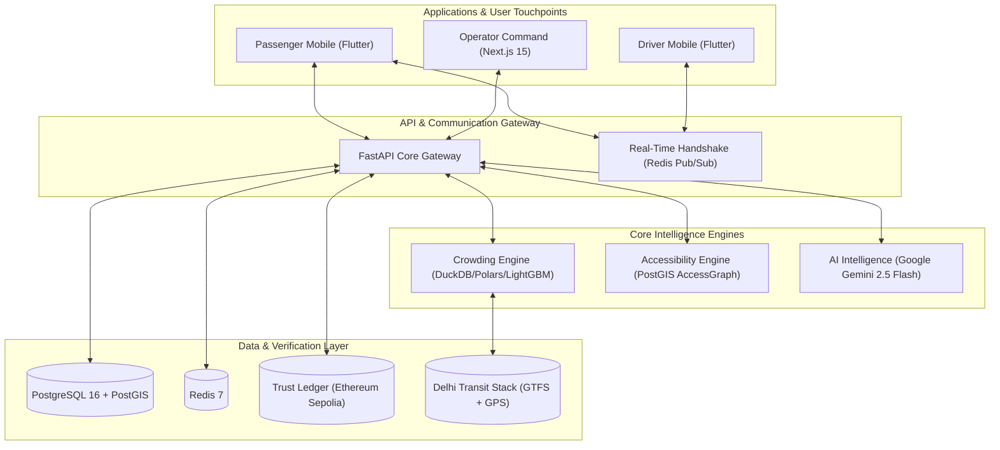

# YATRA — Your Accessible Transport & Reliable Assistance Platform

> **"Every Passenger. Every Bus. Every Journey."**

YATRA is an open-source, universal public transit accessibility, operations, and intelligence platform designed to eliminate physical, communicative, and cognitive barriers in municipal bus transit systems.

---

## 1. Product Overview & Vision

Public bus transit is the lifeline of megacities like Delhi, carrying millions of daily commuters. However, passengers with disabilities, the elderly, parents with strollers, and unfamiliar commuters encounter severe friction:
- Inaccessible bus stops and curbs with no prior accessibility intelligence.
- Inability to signal bus drivers before boarding, resulting in buses stopping away from ramps or failing to lower kneeling mechanisms.
- Extreme bus crowding without real-time transparency or occupancy forecasting.
- Drivers lacking situational awareness of boarding passengers needing assistance.
- Transport authorities lacking verifiable inspection and resolution auditing.

**YATRA** bridges this gap by unifying five core user groups on an accessible, real-time, privacy-preserving infrastructure.

---

## 2. Five User Groups

| User Group | Platform Interface | Value Proposition |
| :--- | :--- | :--- |
| **1. Commuters & Passengers** | Universal Passenger App (`apps/passenger-mobile`) | Crowding-aware trip planning, live arrival tracking, multimodal routing. |
| **2. Drivers & Conductors** | DriverAssist App (`apps/driver-mobile`) | Audio/visual pre-stop boarding handshake, accessibility assistance alerts. |
| **3. Operators & Dispatchers** | Operator Command (`apps/operator-web`) | Fleet telemetry, crowding monitoring, accessibility incident resolution. |
| **4. Passengers with Disabilities** | Universal Passenger App (A11y Mode) | High-contrast/screen-reader UI, wheelchair ramp requests, audio assistance. |
| **5. Transport Authorities** | Government Intelligence | Aggregated compliance metrics, verifiable audit trails, corridor analytics. |

---

## 3. Core Product Modules

- **AccessGraph**: Pedestrian and bus-stop accessibility graph mapping curb cuts, ramps, tactile paving, and shelter amenities.
- **AccessHandshake**: Real-time WebSocket/Redis-backed signaling protocol connecting waiting passengers with approaching bus drivers.
- **DriverAssist**: Hands-free, high-contrast operational driver console delivering audio/visual stop alerts.
- **Operator Command**: Next.js desktop dispatch dashboard for monitoring fleet health, resolving accessibility incidents, and managing routes.
- **Crowd Intelligence**: Deterministic and machine-learning bus crowding estimation engine utilizing Delhi GPS telemetry and e-ticketing data.
- **Trust Ledger**: Ethereum Sepolia smart contract anchoring cryptographic audit hashes for accessibility inspections and resolved service tickets without storing sensitive PII on-chain.

---

## 4. Architecture Summary



---

## 5. Repository Structure

```
yatra/
│
├── apps/
│   ├── passenger-mobile/          # Flutter passenger application (iOS/Android/Web)
│   ├── driver-mobile/             # Flutter driver tablet/phone application
│   └── operator-web/              # Next.js 15 App Router operator command dashboard
│
├── services/
│   ├── api/                       # Core FastAPI application (REST & WebSockets)
│   ├── crowding-engine/           # Bus occupancy & travel time prediction engine
│   ├── accessibility-engine/      # Stop accessibility scoring & routing graph
│   ├── handshake-engine/          # Passenger-to-driver real-time handshake service
│   ├── intelligence-engine/       # Google Gemini Gen AI contextual explanations
│   └── notification-service/      # Push and audio notification dispatch
│
├── blockchain/
│   ├── contracts/                 # Solidity smart contracts (TrustLedger.sol)
│   ├── scripts/                   # Foundry deployment & verification scripts
│   └── test/                      # Foundry unit & integration tests
│
├── packages/
│   ├── shared-types/              # Shared TypeScript definitions
│   ├── api-client/                # Typed API client library for frontend & node
│   └── design-system/             # Reusable accessible components & tokens
│
├── data/
│   ├── raw/                       # Raw input datasets (gitignored)
│   ├── processed/                 # Cleaned Parquet / DuckDB storage
│   ├── gtfs/                      # Delhi static GTFS schedules & routes
│   ├── gps/                       # Delhi bus GPS telemetry samples
│   ├── ticketing/                 # Delhi e-ticketing transaction summaries
│   └── sample/                    # Verified synthetic and minimal test fixtures
│
├── docs/
│   ├── product/                   # PRD, user personas, journeys
│   ├── architecture/              # System architecture, ADRs, tech stack
│   ├── api/                       # OpenAPI contract and schema specifications
│   ├── database/                  # PostGIS entity schemas, ERD, spatial indexes
│   ├── research/                  # Delhi Transit Stack analysis & ML strategy
│   ├── security/                  # Security policy, RBAC, privacy boundaries
│   ├── accessibility/             # WCAG 2.2 AA compliance standards
│   ├── blockchain/                # Trust ledger architecture & threat model
│   └── development/               # Comprehensive developer setup guide
│
├── scripts/                       # Local automation, seeders, data loaders
├── tests/                         # Integration, unit, and end-to-end fixtures
├── .env.example                   # Environment configuration template
├── .gitignore                     # Git ignore rules
├── Makefile                       # Developer command interface
├── docker-compose.yml             # Local PostgreSQL/PostGIS and Redis services
└── LICENSE                        # Apache 2.0 Open Source License
```

---

## 6. Development Prerequisites

- **Python**: 3.12+ (isolated `.venv`)
- **Node.js**: 20+ (with npm 10+)
- **Flutter & Dart**: Flutter 3.13+ / Dart 3.1+
- **Docker**: Optional, for running local PostgreSQL 16 + PostGIS and Redis
- **Foundry**: Optional, for compiling and testing smart contracts

---

## 7. Quickstart Commands

```bash
# 1. Clone repository
git clone https://github.com/MustafaPinjari/Yatra.git
cd Yatra

# 2. Copy environment template
cp .env.example .env

# 3. Start local development database and cache (optional if using external Postgres/Redis)
docker compose up -d

# 4. Set up Python virtual environment and API dependencies
py -3.12 -m venv .venv
# Activate virtual environment:
# Windows (PowerShell): .venv\Scripts\Activate.ps1
# Linux/macOS: source .venv/bin/activate
pip install -e "services/api[dev]"

# 5. Run FastAPI Backend
uvicorn app.main:app --app-dir services/api --reload --port 8000

# 6. Run Operator Web Dashboard
cd apps/operator-web
npm install
npm run dev
```

---

## 8. Development Status

| Component | Status | Target Milestone |
| :--- | :--- | :--- |
| Monorepo Architecture | :white_check_mark: Complete | Foundation |
| Core Documentation & Specs | :white_check_mark: Complete | Foundation |
| FastAPI Backend Core & Health | :white_check_mark: Complete | Phase 1 Prototype |
| Operator Web Dashboard | :white_check_mark: Initialized | Phase 1 Prototype |
| Passenger Mobile Application | :hammer_and_wrench: Initializing | Phase 1 Prototype |
| Driver Assist Mobile Application | :hammer_and_wrench: Initializing | Phase 1 Prototype |
| PostGIS Spatial Schemas | :white_check_mark: Documented | Phase 1 Prototype |
| Crowd Intelligence Engine | :memo: Scaffolding | Phase 1 Prototype |
| Trust Ledger Contract | :white_check_mark: Initialized | Phase 2 Audit |

