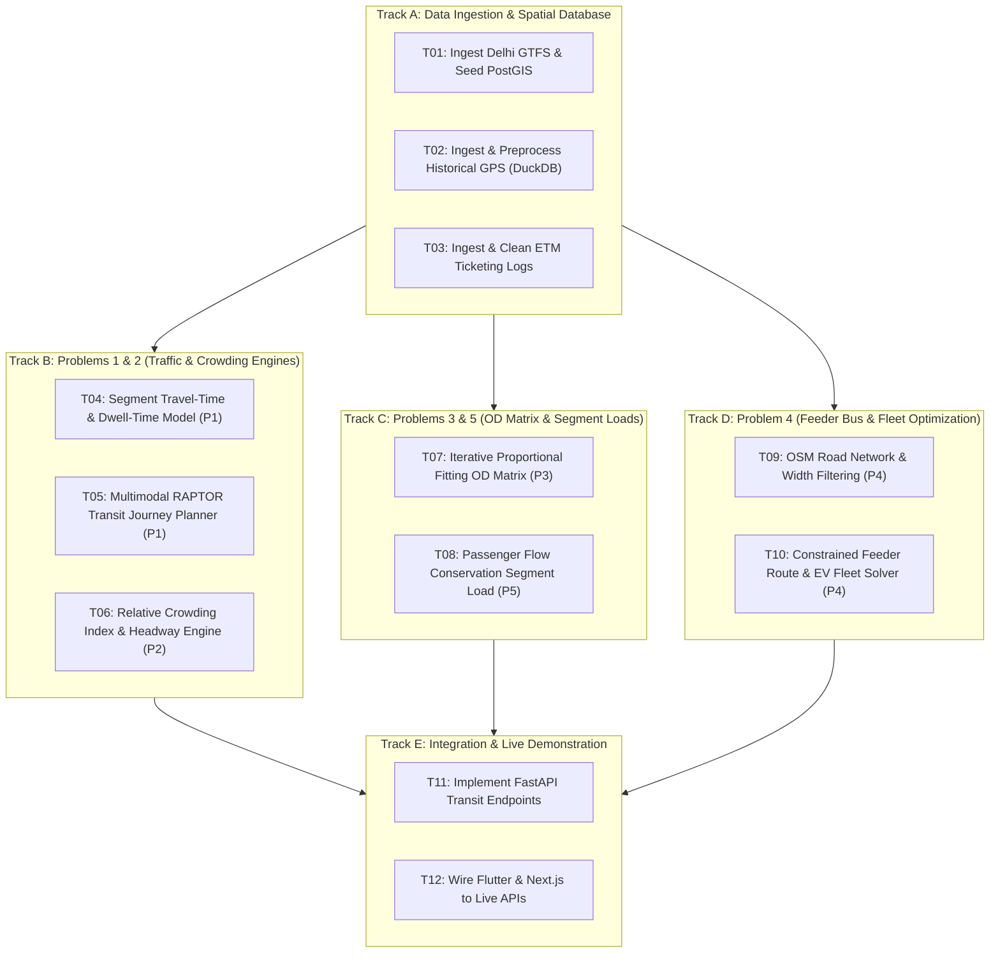

# YATRA — Winning-Quality Implementation Roadmap

**Document ID:** AUDIT-DOC-08  
**Objective:** End-to-End Implementation Plan for ALL FIVE Problem Statements  
**Target Event:** Delhi Transport Stack Hackathon 2026  
**Guiding Principle:** Local development, reproducible pipelines, zero paid external APIs, zero phase compromise.  

---

## 1. Roadmap Architecture: Five Parallel Engineering Tracks

---

## 2. Detailed Task Specifications

### Track A: Data Ingestion & Spatial Database

#### Task T01: Delhi GTFS Ingestion & PostGIS Database Seeding
- **Problem Statement:** Foundation (P1–P5)
- **Objective:** Ingest full Delhi bus stops (~4,500) and routes (~800) into PostGIS spatial tables.
- **Files to Modify:** `services/api/app/models/__init__.py`, `services/api/app/db/session.py`.
- **New Files to Create:** `services/api/app/models/transit.py`, `scripts/ingest_gtfs.py`.
- **Dataset:** Delhi Open Data Static GTFS (`opendata.delhi.gov.in`).
- **Technical Approach:** Use DuckDB/Pandas to parse `stops.txt`, `routes.txt`, `trips.txt`, `shapes.txt`. Insert into PostgreSQL using GeoAlchemy2 with spatial GIST indexes.
- **Definition of Done:** `GET /api/v1/stops?lat=28.61&lng=77.23&radiusKm=2` returns real nearby stops from PostGIS in $< 50\text{ ms}$.
- **Estimated Effort:** 4 hours.

#### Task T02: Historical GPS Trajectory Cleaning & Map Matching
- **Problem Statement:** Problem 1
- **Objective:** Clean October 2026 DTC GPS traces and compute baseline segment travel times.
- **New Files to Create:** `services/api/app/engines/traffic_engine.py`, `scripts/process_gps_duckdb.py`.
- **Dataset:** Daily GPS SQLite archives (`delhi_bus_gps_oct2026`).
- **Technical Approach:** Filter bounding box ($28.4^\circ \text{N} \le \text{Lat} \le 28.9^\circ \text{N}$), remove GPS speed glitches ($> 80\text{ km/h}$), snap coordinates to route polylines using Shapely, extract dwell times when speed $< 2\text{ km/h}$ within stop buffers.
- **Definition of Done:** Generates Parquet file containing 15-minute median segment travel times across all route segments.
- **Estimated Effort:** 6 hours.

#### Task T03: ETM Ticketing Normalization & Stage Alignment
- **Problem Statement:** Problem 2, 3, 5
- **Objective:** Parse 2.56M ETM ticketing records, resolve stop names to GTFS `stop_id`, and compute hourly boarding totals.
- **New Files to Create:** `services/api/app/engines/ticketing_engine.py`, `scripts/process_etm.py`.
- **Dataset:** October 2026 ETM Ticket CSV dump.
- **Technical Approach:** Normalize ticketing stage strings using fuzzy matching against GTFS stop names. Aggregate transactions into (Route, Direction, Stop, 30-min window) buckets.
- **Definition of Done:** Clean Parquet summary table of boarding demand per stop per time band.
- **Estimated Effort:** 4 hours.

---

### Track B: Problems 1 & 2 (Traffic & Crowding Engines)

#### Task T04: Time-Dependent Travel-Time & Dwell-Time Model
- **Problem Statement:** Problem 1
- **Objective:** Predict bus travel time and arrival ETA based on time of day, day of week, and historical delay distributions.
- **Files to Modify:** `services/api/app/engines/traffic_engine.py`.
- **Technical Approach:** Compute historical travel-time distributions (median, 25th, 75th, 95th percentiles) per route segment. Blend with live vehicle headway where telemetry is present.
- **Definition of Done:** Returns expected trip duration and 90% confidence interval for any departure timestamp. MAE $< 4.5\text{ minutes}$ against observed trips.
- **Estimated Effort:** 6 hours.

#### Task T05: Multimodal RAPTOR Transit Journey Planner
- **Problem Statement:** Problem 1
- **Objective:** Compute Pareto-optimal transit itineraries between any origin and destination in Delhi.
- **New Files to Create:** `services/api/app/engines/journey_planner.py`.
- **Technical Approach:** Implement RAPTOR (Round-Based Public Transit Routing) in Python over GTFS timetable arrays. Support walking access, bus transfer legs, and egress.
- **Definition of Done:** Querying $(28.6675, 77.2285)$ to $(28.5175, 77.1820)$ returns 3 ranked itineraries with exact boarding stops, transfers, and durations in $< 200\text{ ms}$.
- **Estimated Effort:** 8 hours.

#### Task T06: Calibrated Relative Crowding Index & Headway Bunching Engine
- **Problem Statement:** Problem 2
- **Objective:** Evaluate crowding across journey itineraries, taking into account the 3–4% ETM capture rate and bus bunching.
- **New Files to Create:** `services/api/app/engines/crowding_engine.py`.
- **Technical Approach:** Compute Relative Crowding Index:
  $$\text{RCI} = 0.5 \cdot \text{NormalizedTicketingRate} + 0.3 \cdot \text{HeadwayDeviationFactor} + 0.2 \cdot \text{HistoricalPeakWeight}$$
  Rank itineraries with passenger utility score: $U = - (\alpha \cdot \text{Time} + \beta \cdot \text{RCI} \cdot \text{Time})$.
- **Definition of Done:** Journey planner returns explainable crowding tags (`Low`, `Moderate`, `High`, `Very High`) with confidence scores.
- **Estimated Effort:** 6 hours.

---

### Track C: Problems 3 & 5 (OD Matrix & Segment Loads)

#### Task T07: Biproportional Fitting (IPF) Transit Origin–Destination Engine
- **Problem Statement:** Problem 3
- **Objective:** Generate peak and off-peak public transit OD matrices combining bus ticketing stages and DMRC metro gate entries/exits.
- **New Files to Create:** `services/api/app/engines/od_engine.py`.
- **Technical Approach:** Formulate Furness Iterative Proportional Fitting balancing station marginals with negative exponential impedance gravity friction. Export zone-to-zone matrices.
- **Definition of Done:** Exports valid OD matrix in GeoJSON/CSV with downloadable summary and interactive desire line visualization.
- **Estimated Effort:** 8 hours.

#### Task T08: Segment-Level Passenger Load & Conservation Model
- **Problem Statement:** Problem 5
- **Objective:** Model inter-stop vehicle occupancy and segment load curves enforcing conservation of flow ($L_i = L_{i-1} + B_i - A_i$).
- **New Files to Create:** `services/api/app/engines/segment_load_engine.py`.
- **Technical Approach:** Model alighting probabilities using distance-decay distribution from ticket fare stages. Disaggregate direction-wise hourly segment loads.
- **Definition of Done:** Computes peak segment load, identifying critical bottlenecks along corridors.
- **Estimated Effort:** 6 hours.

---

### Track D: Problem 4 (Feeder Bus & Fleet Optimization)

#### Task T09: Delhi Road Network Graph & Carriageway Width Filtering
- **Problem Statement:** Problem 4
- **Objective:** Construct a routable road graph around target metro stations, filtering out roads narrower than 6 metres.
- **New Files to Create:** `services/api/app/engines/feeder_graph.py`, `scripts/extract_osm_roads.py`.
- **Technical Approach:** Ingest OSM road network using OSMnx/NetworkX. Filter edges where `width >= 6.0` or `lanes >= 2` (or street classifications permitting mid-size electric feeder buses).
- **Definition of Done:** NetworkX graph containing only feeder-eligible road edges within a 5 km radius of metro hubs.
- **Estimated Effort:** 6 hours.

#### Task T10: Constrained Feeder Route Generator & 500 EV Fleet Scheduler
- **Problem Statement:** Problem 4
- **Objective:** Generate optimal feeder routes connecting metro stations to surrounding unserved settlements under the 7 km length cap and 500 electric bus fleet constraint.
- **New Files to Create:** `services/api/app/engines/feeder_optimizer.py`.
- **Technical Approach:** Candidate route generation using loop-closing shortest paths ($\le 7\text{ km}$). Solve fleet allocation with Google OR-Tools CP-SAT to maximize demand coverage while total bus count $\le 500$.
- **Definition of Done:** Outputs GeoJSON feature collection of optimized feeder routes with headway schedules and fleet assignments.
- **Estimated Effort:** 10 hours.

---

### Track E: Integration & Live Demonstration

#### Task T11: FastAPI Transit Endpoints Implementation
- **Problem Statement:** Integration (P1–P5)
- **Objective:** Expose the 5 analytical engines via clean, versioned REST endpoints matching `packages/api-contracts`.
- **Files to Modify:** `services/api/app/api/v1/api.py`.
- **New Files to Create:** `services/api/app/api/v1/endpoints/transit.py`, `services/api/app/api/v1/endpoints/analytics.py`.
- **Definition of Done:** `/api/v1/journey/plan`, `/api/v1/od/matrix`, `/api/v1/feeder/optimize`, `/api/v1/operator/fleet/live` return live JSON outputs tested via automated pytest.
- **Estimated Effort:** 6 hours.

#### Task T12: Frontend Live API Integration
- **Problem Statement:** Integration (P1–P5)
- **Objective:** Replace static client state in Flutter and Next.js with real API data calls.
- **Files to Modify:** `apps/passenger-mobile/lib/features/planner/`, `apps/operator-web/src/components/screens/`.
- **Definition of Done:** Interactive journey searches in Flutter and analytical filters in Next.js dynamically query the running FastAPI backend and render live results.
- **Estimated Effort:** 6 hours.
