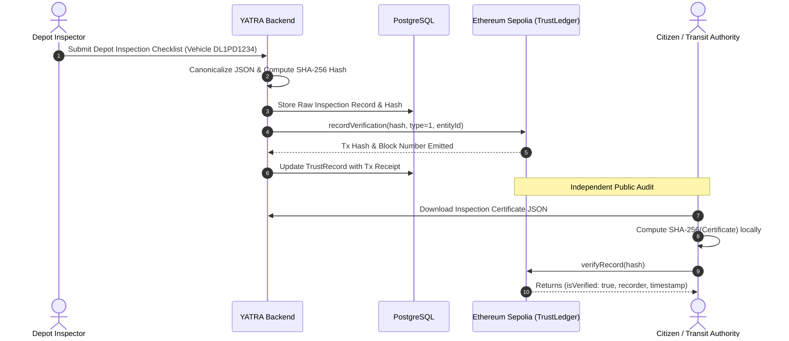

# YATRA — Trust Ledger Architecture & Smart Contract Design

**Document Version:** 1.0.0  
**Target Network:** Ethereum Sepolia Testnet  
**Framework:** Solidity 0.8.24 + Foundry  
**Author:** Blockchain Lead & Systems Architect  

---

## 1. Why Blockchain? (The Problem of Verification)

In public transit networks, compliance monitoring (e.g., verifying whether bus wheelchair ramps are operational, whether kneeling suspension was inspected, or whether passenger assistance grievances were resolved) faces a trust deficit:
- **Centralized Vulnerability:** Internal databases can be altered retroactively by operators facing financial penalties for missed accessibility quotas.
- **Auditor Independence:** Transport authorities (e.g., Department of Transport, DTC, DIMTS) and citizen accessibility advocates require an indisputable, immutable mathematical proof of audit logs.

By anchoring cryptographic fingerprints (SHA-256 hashes) to an immutable public blockchain, YATRA guarantees that inspection records cannot be forged, backdated, or tampered with.

---

## 2. On-Chain vs. Off-Chain Separation

To comply strictly with the Digital Personal Data Protection (DPDP) Act and GDPR, YATRA enforces a total separation between evidence and verification metadata:

| Attribute | Storage Location | Reasoning |
| :--- | :--- | :--- |
| **Inspection Checklist JSON** | Off-chain (PostgreSQL / IPFS) | Detailed technical notes, timestamps, vehicle VIN. |
| **Photographic Proof of Ramp/Curb** | Off-chain (Encrypted Object Storage) | High storage cost, potential privacy leaks. |
| **Inspector Identity & Employee ID** | Off-chain (PostgreSQL) | Internal HR and employee privacy. |
| **Passenger Grievance Description** | Off-chain (PostgreSQL) | Passenger privacy and confidentiality. |
| **SHA-256 Canonical Record Hash** | **On-Chain (`bytes32`)** | Mathematical fingerprint of the inspection payload. |
| **Record Type (Inspection / Resolution)** | **On-Chain (`uint8`)** | Category index for on-chain querying. |
| **Authorized Auditor Ethereum Address** | **On-Chain (`address`)** | Cryptographic signature of the inspecting authority. |
| **Block Timestamp** | **On-Chain (`uint256`)** | Immutable proof of existence in time. |

---

## 3. Smart Contract Architecture (`TrustLedger.sol`)

The `TrustLedger` smart contract is implemented in Solidity using **OpenZeppelin Contracts** (`AccessControl`, `ReentrancyGuard`):

### 3.1 Contract Roles
- `DEFAULT_ADMIN_ROLE`: Contract owner; manages authorized inspector roles.
- `INSPECTOR_ROLE`: Municipal depot auditors, depot supervisors, and designated transport safety officers permitted to record verified inspection hashes.
- `RESOLVER_ROLE`: Fleet grievance officers authorized to record verified accessibility ticket resolutions.

### 3.2 State Structure
```solidity
struct Record {
    bytes32 recordHash;       // SHA-256 hash of the canonical JSON certificate
    uint8 recordType;         // 1: Accessibility Inspection, 2: Grievance Resolution
    address recorder;         // Ethereum address of the inspector
    uint256 blockTimestamp;   // Block timestamp
    string entityIdentifier;  // Public pseudonymized ID (e.g. "DL1PD1234-2026-11-18")
}
```

---

## 4. End-to-End Verification Workflow



---

## 5. Network Selection & Gas Optimization

- **Testnet:** Ethereum **Sepolia** was selected for its long-term testnet stability, wide RPC node availability (Alchemy, Infura, public nodes), and zero real-world cost.
- **Gas Minimization:**
  - Storage is limited to a single `mapping(bytes32 => Record)`.
  - Batch registration (`recordBatchVerifications`) allows recording up to 50 daily depot inspections in a single transaction, reducing gas overhead by over 60%.

