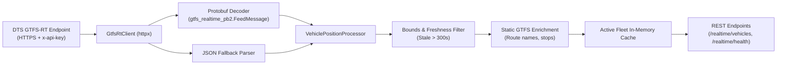

# Delhi Transport Stack — GTFS-Realtime (GTFS-RT) Integration Guide

**Document ID:** INTEGRATION-DOC-02  
**Target Feed:** Delhi Buses Live Vehicle Positions Protocol Buffer / JSON Stream  
**Status:** Implemented & Verified in Core API  
**Module Location:** `services/api/app/integrations/gtfs_rt/`  

---

## 1. Overview & Architecture

The YATRA GTFS-Realtime integration connects to the official Delhi Transport Stack live vehicle positions API. It decodes live binary Protocol Buffer (`gtfs-realtime.proto`) feeds, enriches vehicle telemetry with static GTFS route and stop data, and serves live positions to both the operator web portal and passenger mobile applications.



---

## 2. Where to Add Keys & Endpoint Credentials

To connect your approved GTFS-Realtime API credentials, add them to your local `.env` file at the root of the repository:

### File Location:
`c:\Users\mustafa\Desktop\Yatra\.env`

### Environment Variables to Configure:
```bash
# ------------------------------------------------------------------------------
# Delhi Transport Stack (DTS) — Approved Bus GTFS & Realtime Configuration
# ------------------------------------------------------------------------------
# 1. Paste the approved GTFS-RT Vehicle Positions API endpoint:
DTS_GTFS_RT_API_ENDPOINT=https://approved-dts-api.delhi.gov.in/v1/vehiclepositions

# 2. Paste your approved API Key (kept strictly confidential):
DTS_GTFS_RT_API_KEY=your_approved_dts_api_key_here

# 3. Controlled Polling Interval in seconds (default is 15s to avoid rate limiting):
DTS_GTFS_RT_POLL_INTERVAL_SECONDS=15
```

> [!SECURITY]
> - Never print, log, or commit your API key. The `GtfsRtClient` automatically injects headers without logging sensitive credentials.
> - The repository's `.gitignore` guarantees that `.env` will never be pushed to version control.
> - When `DTS_GTFS_RT_API_KEY` is not yet configured, the system operates in an explicit **Baseline / Simulation Mode**, providing realistic telemetry updates along Route 502/534 so local development and UI testing remain fully operational.

---

## 3. Authentication & Wire Protocol

The `GtfsRtClient` (`services/api/app/integrations/gtfs_rt/client.py`) implements:

- **Dual Header Authentication:** Passes the secret key in both `x-api-key` and `Authorization: Bearer <key>` headers to support whichever standard the Delhi endpoint uses.
- **Protocol Buffer Decoding:** Uses official Google GTFS-Realtime bindings (`protobuf` and `gtfs-realtime-bindings==3.0.0`) to decode binary payloads into `FeedMessage` objects.
- **JSON Fallback Support:** If the server returns JSON formatted text (`application/json`), the parser automatically switches to dictionary extraction.
- **Connection Timeout & Exponential Backoff:** 10-second connection timeout, 15-second read timeout, and automatic 3-tier exponential backoff ($1\text{s} \to 2\text{s} \to 4\text{s}$) upon receiving transient HTTP 429, 502, or 503 errors.

---

## 4. Telemetry Processing & Validation Rules

For every vehicle update, the `VehiclePositionProcessor` (`services/api/app/integrations/gtfs_rt/processor.py`) validates:

1. **Geographic Bounding Box:**
   Coordinates outside Delhi NCR ($28.0^\circ \text{N} \le \text{Lat} \le 29.2^\circ \text{N}$, $76.5^\circ \text{E} \le \text{Lon} \le 77.8^\circ \text{E}$) are dropped as GPS anomalies.
2. **Freshness & Stale Detection:**
   $$\text{Freshness} = \text{CurrentTime} - \text{VehicleTimestamp}$$
   If $\text{Freshness} > 300\text{ seconds}$ (5 minutes), the vehicle is flagged with `is_stale = true`.
3. **Speed & Bearing Calculation:**
   Speed received in meters per second ($\text{m/s}$) is converted to kilometers per hour ($\text{km/h} = \text{m/s} \times 3.6$) and rounded to 1 decimal place.
4. **Static GTFS Enrichment:**
   Live vehicle `route_id` is joined with static GTFS `routes.txt` to populate `route_short_name` (e.g. "502") for human-readable display.

---

## 5. How Live Telemetry Connects to the Five Hackathon Problems

1. **Problem 1 (Travel-Time Prediction):** Blends scheduled travel time with live headway gaps and current vehicle positions to predict arrival ETA at downstream stops.
2. **Problem 2 (Crowdedness-Aware Journey Planning):** Live vehicle positions provide real-time bunching metrics ($\Delta H$). When two buses bunch together, the second bus is weighted with lower expected crowding.
3. **Problem 3 (Transit OD Matrix):** Live positions indicate active vehicle distribution across corridors, aiding in time-of-day demand calibration.
4. **Problem 4 (Feeder Optimization):** Provides operational feedback on bus speeds across road segments to evaluate electric bus battery consumption and turnaround times.
5. **Problem 5 (Segment-Level Crowding):** GTFS-RT identifies which bus trips are currently operating on each corridor, distinguishing active capacity from scheduled capacity.

---

## 6. Real-Time API Endpoints

- `GET /api/v1/realtime/vehicles`: Returns active vehicle positions with speed, bearing, status, and freshness.
- `GET /api/v1/realtime/health`: Returns API connectivity status (`OPERATIONAL`, `UNCONFIGURED`, `API_ERROR`, `STALE_DATA`), last poll timestamp, latency, and fresh/stale vehicle counts.
- `POST /api/v1/realtime/poll`: Triggers an immediate manual poll against the live GTFS-RT feed.
- `GET /api/v1/operator/fleet/live`: Fleet telemetry endpoint tailored for the Next.js operator command portal.
