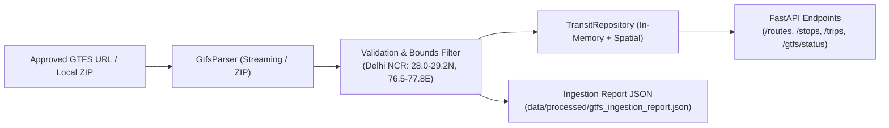

# Delhi Transport Stack — GTFS Static Data Integration Guide

**Document ID:** INTEGRATION-DOC-01  
**Target Feed:** Delhi Buses (DTC & DIMTS) GTFS Static Archive  
**Status:** Implemented & Verified in Core API  
**Module Location:** `services/api/app/integrations/gtfs/`  

---

## 1. Overview & Architecture

The YATRA GTFS Static integration pipeline provides robust, repeatable, and idempotent ingestion of official Delhi Transport Corporation (DTC) and Delhi Integrated Multi-Modal Transit System (DIMTS) schedule data.

It operates seamlessly from either:
1. An official approved download URL provided by the project owner.
2. A local ZIP archive placed in `data/raw/delhi_gtfs_latest.zip`.
3. An extracted directory of `.txt` files placed in `data/gtfs/`.
4. Pre-loaded bootstrap fixtures in `data/sample/` for immediate local development.



---

## 2. Where to Add Keys & Approved URLs

To connect your approved GTFS Static download link, add the URL to your local, ignored `.env` file at the root of the repository:

### File Location:
`c:\Users\mustafa\Desktop\Yatra\.env`

### Environment Variable:
```bash
# ------------------------------------------------------------------------------
# Delhi Transport Stack (DTS) — Approved Bus GTFS & Realtime Configuration
# ------------------------------------------------------------------------------
# Paste the official approved download link supplied separately by the project owner:
DTS_GTFS_STATIC_URL=https://approved-dts-download-portal.delhi.gov.in/gtfs/delhi_buses.zip
```

> [!IMPORTANT]
> - Never commit `.env` to Git. `.gitignore` is already configured to strictly exclude `.env` and `.env.*`.
> - If you have a local `.zip` file instead of a URL, simply copy it to `data/raw/delhi_gtfs_latest.zip` or extract the files into `data/gtfs/`.

---

## 3. Discovered Files & Validation Pipeline

The `GtfsParser` (`services/api/app/integrations/gtfs/parser.py`) inspects and processes all standard and optional GTFS files:

| File Name | Mandatory | Processing Logic | Validation Performed |
| :--- | :---: | :--- | :--- |
| `agency.txt` | Yes | Ingests transit authority metadata (DTC, DIMTS). | Preserves `agency_id`, time zone (`Asia/Kolkata`). |
| `stops.txt` | Yes | Ingests geocoded bus stops and shelters. | Bounding box check ($28.0 \le \text{lat} \le 29.2$, $76.5 \le \text{lon} \le 77.8$), coordinate parsing, wheelchair boarding flags. |
| `routes.txt` | Yes | Ingests route codes (502, 534, TMS, 729, etc.). | Validates `route_id`, assigns route colors. |
| `trips.txt` | Yes | Ingests directional scheduled runs. | Foreign key check against `routes.txt`. |
| `stop_times.txt` | Yes | Ingests sequence-ordered arrival/departure times. | Foreign key checks against `stops.txt` and `trips.txt`. |
| `shapes.txt` | Optional | Ingests high-resolution polyline coordinates. | Orders sequence points for map plotting. |
| `calendar.txt` | Optional | Ingests day-of-week service validity. | Date ranges and holiday exceptions. |
| `calendar_dates.txt` | Optional | Ingests schedule date exceptions. | Reconciles active service IDs. |

---

## 4. How Static GTFS Connects to the Five Hackathon Problems

1. **Problem 1 (Traffic Model & Journey Planner):** Supplies the foundational schedule graph (routes, trips, and stop times) used by the RAPTOR transit planner to compute multi-leg itineraries and transfers.
2. **Problem 2 (Crowdedness Planner):** Links passenger ticketing transactions to exact stop-to-stop route sequences.
3. **Problem 3 (Transit OD Matrix):** Provides geocoded bus stops and route alignments to aggregate spatial passenger flows into administrative zones.
4. **Problem 4 (Feeder Optimization):** Provides physical bus stop coordinates to identify transfer hubs and calculate road distance from DMRC metro stations.
5. **Problem 5 (Segment-Level Crowding):** Defines the directional order of stops along each corridor ($s_1 \to s_2 \dots \to s_n$) required to enforce passenger flow conservation ($L_i = L_{i-1} + B_i - A_i$).

---

## 5. API Endpoints

- `GET /api/v1/gtfs/status`: Ingestion report, file inventory, geographic bounds, total stops and routes.
- `POST /api/v1/gtfs/ingest`: Trigger immediate re-ingestion from configured URL or local archive.
- `GET /api/v1/routes`: List all transit routes with optional search filter.
- `GET /api/v1/routes/{route_id}`: Route details.
- `GET /api/v1/routes/{route_id}/stops`: Ordered stop sequence.
- `GET /api/v1/stops`: List stops with spatial radius query (`lat`, `lon`, `radius_km`).
- `GET /api/v1/stops/{stop_id}`: Detailed stop metadata and accessibility score.
