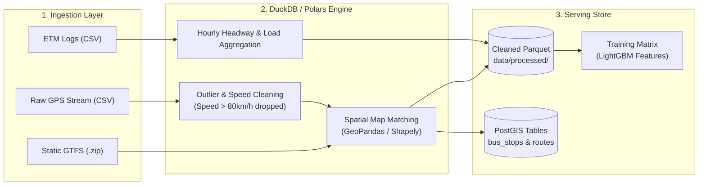

# YATRA — Delhi Transport Stack Data Strategy & Engineering Plan

**Document Version:** 1.0.0  
**Data Domain:** Delhi Integrated Multi-Modal Transit System (DIMTS) & DTC Datasets  
**Author:** Principal Data Engineer & System Architect  

---

## 1. Overview of Transit Data Assets

The Phase 1 prototype of YATRA targets the Delhi municipal bus ecosystem, utilizing open transit data assets provided by the Delhi Open Data Portal and the Delhi Transport Department:

1. **Delhi Static GTFS (General Transit Feed Specification):**
   - Standard transit schedule feed describing the planned network:
     - `agency.txt`: Delhi Transport Corporation (DTC) and DIMTS cluster bus agencies.
     - `routes.txt`: Bus route numbers (e.g., 502, 534, 729, TMS(+)).
     - `trips.txt`: Scheduled trips across morning, afternoon, and evening peak headways.
     - `stops.txt`: Geocoded bus stop locations across the National Capital Territory.
     - `stop_times.txt`: Arrival and departure times per stop along route sequences.

2. **GTFS-Realtime Feed (GTFS-RT):**
   - Protocol buffer (`.pb`) vehicle position and trip update streams broadcasting real-time bus lat/lon coordinates and delay estimates.

3. **October 2026 Bus GPS Telemetry Logs (Historical Hackathon Stack):**
   - High-volume raw CSV/Parquet dump of vehicle location records logged at 10-second intervals across thousands of active Delhi buses.
   - Core fields: `trip_id`, `vehicle_id`, `latitude`, `longitude`, `speed`, `bearing`, `timestamp`.

4. **Electronic Ticketing Machine (ETM) Transaction Data:**
   - Aggregated passenger transaction logs generated by conductor handheld ticketing machines.
   - Core fields: `machine_id`, `route_id`, `stop_stage`, `passenger_count`, `fare_type`, `transaction_timestamp`.

---

## 2. Data Quality Concerns & Real-World Limitations

Based on empirical transit engineering research in Delhi, raw open transport datasets present several documented data anomalies:

1. **GPS Signal Multipath & Canyon Drops:**
   - Dense urban corridors (e.g., Chandni Chowk, Connaught Place, flyover underpasses) cause significant GPS jitter and temporary signal loss lasting 30-180 seconds.
2. **Missing Stop ID Annotations in Telemetry:**
   - Historical GPS streams rarely record the nearest `stop_id`. Spatial snapping algorithms (hidden Markov models or KD-Tree nearest-neighbor projections) are required to map raw GPS points to GTFS stop sequences.
3. **Headway Clustering (Bus Bunching):**
   - Traffic bottlenecks along outer ring roads cause scheduled 10-minute headways to collapse into 0-minute clusters (two buses arriving simultaneously followed by a 25-minute gap).
4. **ETM Ticket Issuance Latency:**
   - ETM tickets are often issued 2-5 minutes after passengers actually board the bus as the conductor moves down the aisle. Ticket timestamps reflect transaction time, not exact boarding arrival.

---

## 3. Privacy & Compliance Boundaries

- **Anonymization:** ETM ticketing data must never include payment instrument identifiers, credit card tokens, or mobile numbers.
- **De-identification:** All driver and conductor operational logs are assigned synthetic pseudonymized IDs during preprocessing.
- **Raw Storage Isolation:** Raw 16+ GB telemetry archives are stored in local uncommitted directories (`data/raw/` and `data/gps/`) protected by `.gitignore` rules to prevent repository bloat.

---

## 4. Data Preprocessing & Pipeline Architecture

### Preprocessing Steps:
1. **Coordinate Bounding Box:** Filter coordinates outside the NCT Delhi geographic bounds:
   `28.40° N <= Lat <= 28.90° N` and `76.80° E <= Lon <= 77.40° E`.
2. **Speed Anomaly Removal:** Telemetry points with calculated speed $> 85\text{ km/h}$ or acceleration $> 4\text{ m/s}^2$ are flagged as GPS glitches and interpolated.
3. **GTFS Stop Sequence Snapping:** Snap GPS coordinates to route polylines using Shapely `project()` to estimate progression along the route.
4. **Occupancy Estimation Heuristic:**
   $$\text{Occupancy}(t) = \sum \text{Boardings}(t) - \sum \text{Alightings}(t)$$
   Calibrated using stop-stage origin-destination probability matrices.

---

## 5. Validation Methodology

1. **Synthetic Fixtures for CI/CD:**
   - To ensure fast, reproducible local testing without requiring the full multi-gigabyte dataset, `data/sample/` maintains verified minimal GTFS files (Route 502 with 10 stops) and synthetic GPS trajectories.
2. **Headway Regularity Score:**
   - Evaluated using Coefficient of Headway Variation ($c_v = \frac{\sigma}{\mu}$):
     - $c_v < 0.2$: Regular service.
     - $0.2 \le c_v \le 0.4$: Irregular service.
     - $c_v > 0.4$: Severe bus bunching.
3. **Accuracy Metrics:**
   - Crowding classification evaluated against holdout validation splits using Multiclass Macro F1-Score and Root Mean Squared Error (RMSE) on passenger load percentages.

